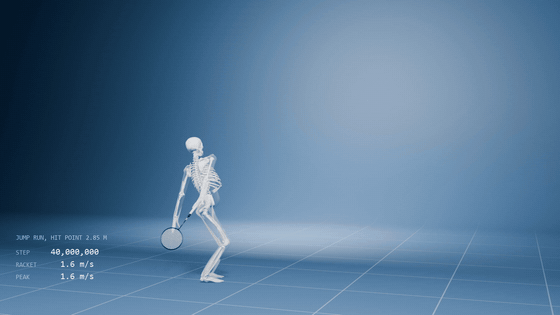

# Hi, I'm Sheng 👋

**English** · [中文](README.zh-CN.md)

I love beautiful things that set a mood, and I want to make interesting ones. What keeps me going is momentum: ship something, see how people react, make it better, and feel the pace pick up. That acceleration is the best rush I know, so I just keep building.

I build with coding agents, mostly Claude Code, and my ideas come from everywhere: art, games, movies, cooking, badminton, Japan and China, and beautiful work by other people. Most of what I make lives in private repos, so this page shows the work instead of the code, plus the skills I build with, which are open.

🐦 [X](https://x.com/shengyuchen) · 🏸 [Smashly](https://smashly.app)

---

## 🏸 Now building: Smashly

**[smashly.app](https://smashly.app)** · paste a YouTube link to a badminton doubles match, get a free highlight reel the same day. It finds the rallies, cuts the dead time between them, and picks the best moments. Built under my company, Repeta Labs.

---

## 🧰 Open: claude-code-skills

[**claude-code-skills**](https://github.com/Schen57/claude-code-skills) · the skills I run every day, each one there because something went wrong without it:

- **review-plan**: three fresh reviewers plus one asked only "is there a simpler way?" before anything gets built
- **start-session / wrap-session / distill**: a workspace that remembers decisions, progress and lessons across sessions
- **write-skill**: change a skill without bloat
- **minto**: answer first, then the support
- **analyze-painting**: what makes a painting work, in plain words

---

## 🔬 Built for myself

**Smash Sim** · a simulated body teaching itself a jump smash. After 40 million practice steps it jumps, hits at 44 m/s, and then mostly falls over. Paused until I film my own smash as the reference.

**Library** · every link I save (videos, posts, papers, paintings) gets transcribed, broken into its slides, music and on-screen text, summarized, and filed on one searchable page.

**Chief of Staff** · a dashboard that collects everything waiting on me across projects and nudges me on Telegram.

---

All of it was built by talking to Claude, one session at a time.
