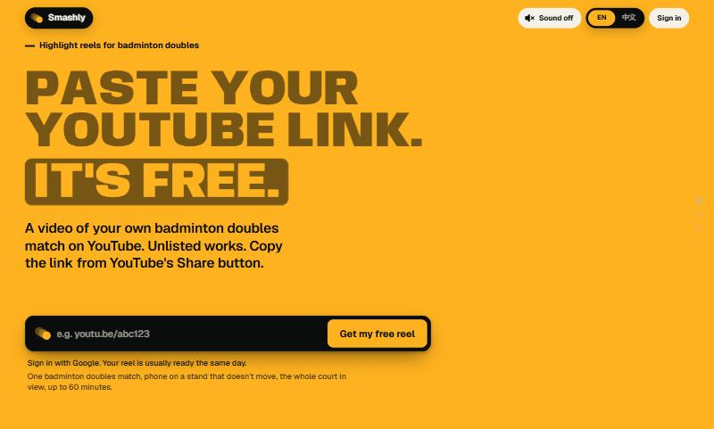
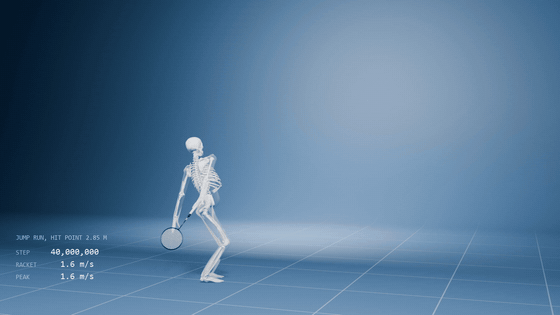

# 你好，我是 Sheng 👋

[English](README.md) · **中文**

我用编程智能体做东西，主要是 Claude Code。灵感大多来自羽毛球、游戏、日本和中国，还有一切好看的东西。我做的大部分项目都在私有仓库里，所以这个页面展示的是作品本身，而不是代码；我搭建它们时用的技能是开源的。

---

## 🏸 正在做：Smashly（闪迹）

**[smashly.app](https://smashly.app)** · 贴上一场羽毛球双打比赛的 YouTube 链接，当天就能免费拿到精彩集锦。它会找出每一个回合，剪掉回合之间的空档，挑出最精彩的瞬间。由我的公司 Repeta Labs 出品。

---

## 🧰 开源：claude-code-skills

[**claude-code-skills**](https://github.com/Schen57/claude-code-skills) · 我每天都在用的技能，每一个都是因为没有它时出过错才写的：

- **review-plan**：动手之前，三个全新的评审，再加一个只问"有没有更简单的办法"
- **start-session / wrap-session / distill**：让工作区跨会话记住决定、进度和教训
- **write-skill**：改技能不让它越写越臃肿
- **minto**：先说结论，再给支撑
- **analyze-painting**：用大白话讲清一幅画为什么好看

---

## 🔬 给自己做的

**Smash Sim** · 一个模拟人体自己学跳杀。练了 4000 万步之后，它能起跳、以 44 米每秒击球，然后大多会摔倒。等我拍下自己的跳杀作为参考再继续。

**Library（收藏馆）** · 我收藏的每个链接（视频、帖子、论文、画作）都会被转写，拆出幻灯片、音乐和画面文字，写好摘要，放进一个可搜索的页面。

**Chief of Staff（参谋长）** · 一个仪表盘，汇总所有项目里等我处理的事，并在 Telegram 上提醒我。

---

这些都是和 Claude 一次次对话做出来的。
